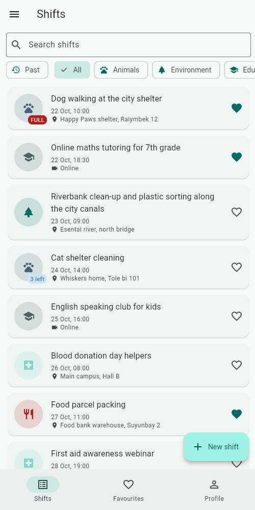
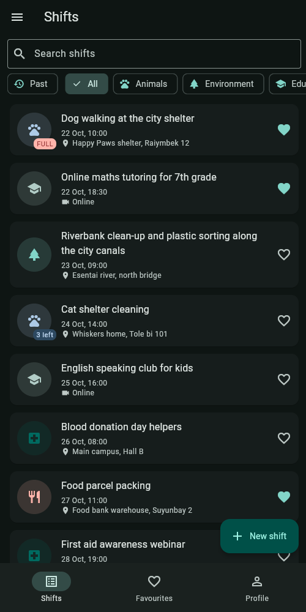
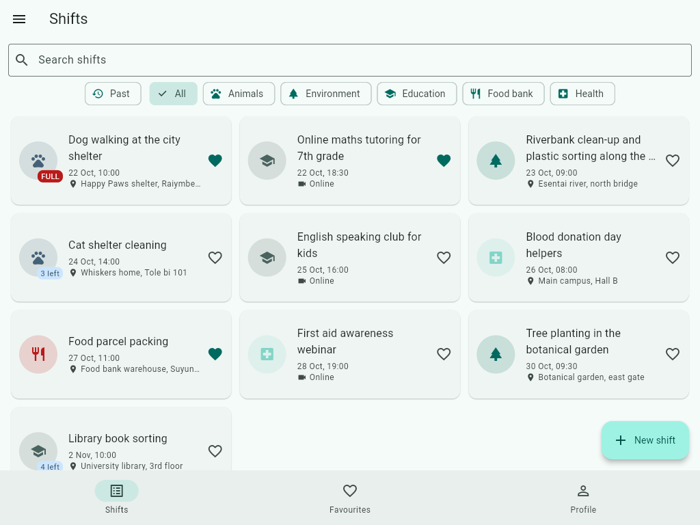

# Helping Hands

Lab 1 — *Your App*. A multi-screen Flutter app for **volunteer shifts**: a shelter
needs dog walkers on Saturday, the food bank needs packers on Monday, a school
needs online tutors tonight. Every shift has a cause, a start time, a number of
places and a list of the volunteers who signed up. All data lives in memory.

| The lab's word | In this app |
|---|---|
| Item | `Shift` — title, cause, starts at, place |
| category | `Cause` (Animals, Environment, Education, Food bank, Health) |
| limit / the list | `slots` vs. `volunteers`; the primary action is **Sign up** / **Withdraw** |
| mode | `isRemote` — an online shift: the place becomes a meeting link (must contain `://`) |
| optional text | `notes` |

Seed data (`lib/data/seed.dart`): twelve shifts dated relative to today, including
a 60-character title (`s1`), a shift at its limit (`s2`), a past shift (`s3`),
an online shift (`s4`) and a shift without notes (`s5`).

## Screenshots

| Phone, light | Phone, dark | Tablet, grid |
|---|---|---|
|  |  |  |

## Run

```bash
flutter run
```

## Structure

```
lib/
  main.dart              MyApp: ThemeMode state, MaterialApp, routes
  routes.dart            Routes constants, DetailArgs/FormArgs, onGenerateRoute, onUnknownRoute
  theme.dart             ColorScheme.fromSeed for light and dark
  models/                Cause (enhanced enum), Shift, Profile, sealed Countdown
  data/seed.dart         twelve seed shifts
  utils/format.dart      18 Oct, 10:00 — no packages
  screens/               shell, shifts/favourites/profile tabs, detail, form
  widgets/               ShiftCard, ShiftAvatar, ShiftCollection, EmptyState, AppDrawer, IconRow
```

## Decisions

The list of shifts and the profile live in the shell's `State`, one level below
`MaterialApp`; the tabs only receive them as constructor parameters and report
changes up through callbacks, so there is exactly one source of truth.
The detail screen takes callbacks in its route arguments because it can change
the shift many times while it is open (sign up, withdraw, edit, delete), and the
list behind it has to follow each change; the form, by contrast, has one job
and one result, so it is awaited with `pushNamed<Shift>` and returns the saved
shift through `pop`, or `null` when the user backs out.
The grid is chosen by `LayoutBuilder` rather than `MediaQuery` because what
matters is the width the list is actually given, not the size of the screen.
The `PopScope` compares a record of the form's current values with the record it
captured in `initState`, so typing a letter and deleting it again leaves the form
clean and backing out does not ask.
With week 9's tools I would move the shifts out of the shell's `State` into a
store that survives restarts (`shared_preferences` or a local database) and
replace the callbacks with a state-management solution so screens stop passing
functions to each other.
